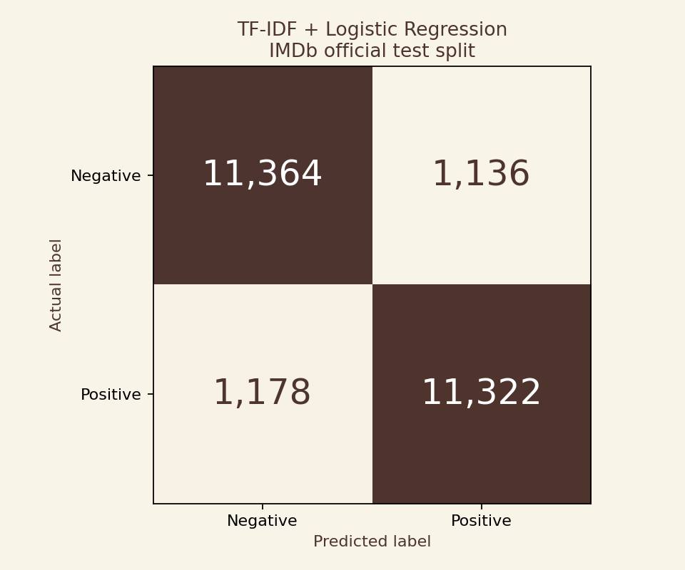
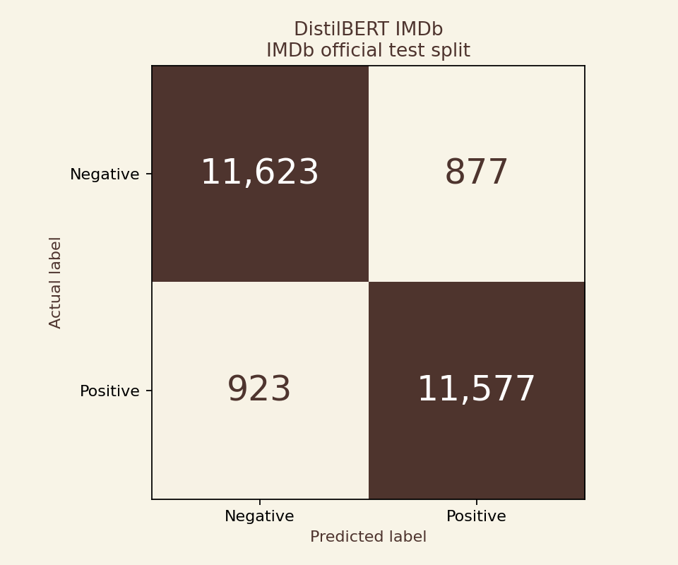
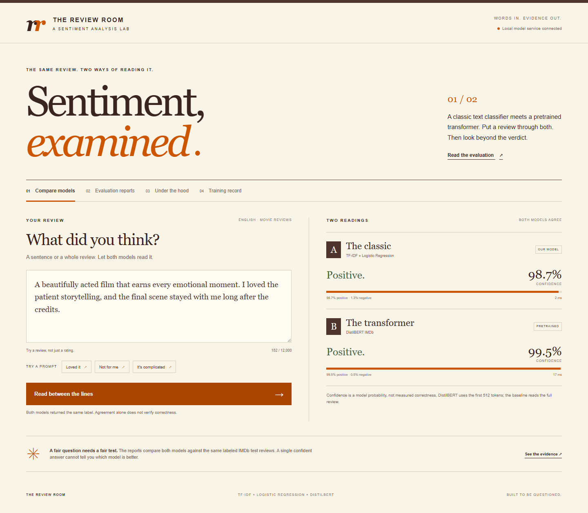
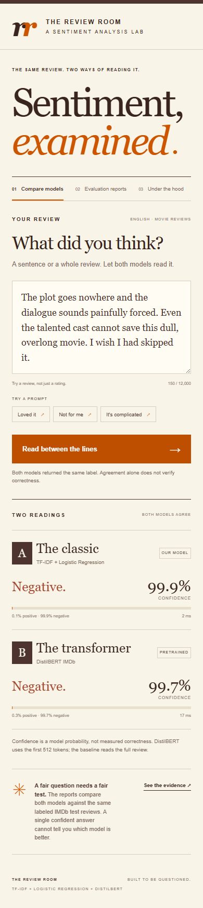
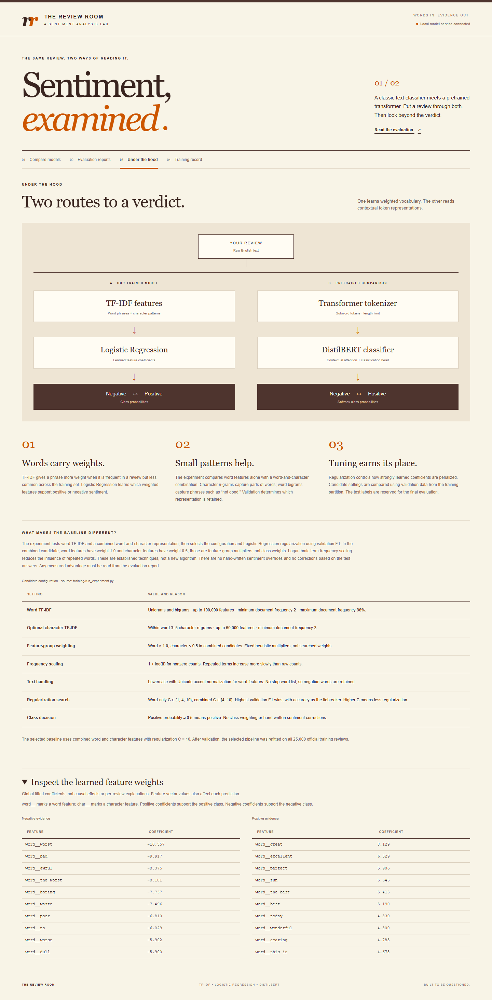
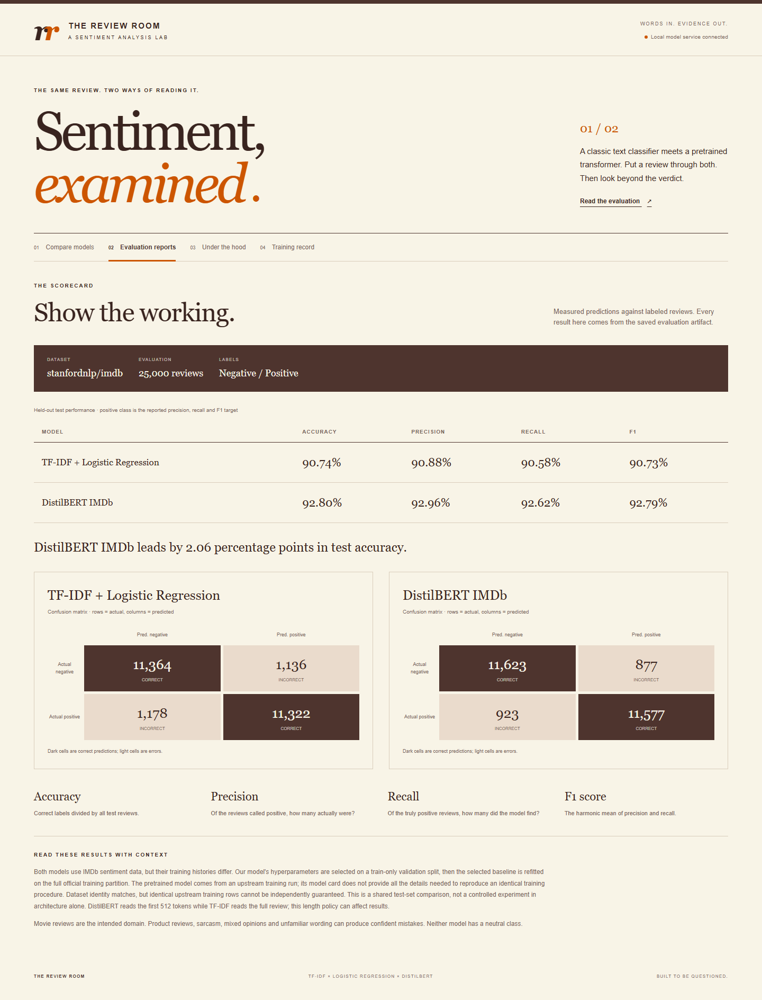
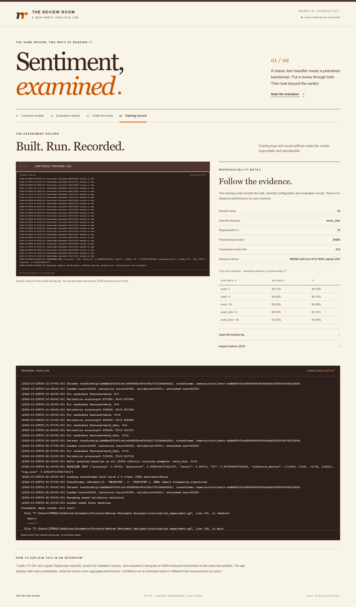
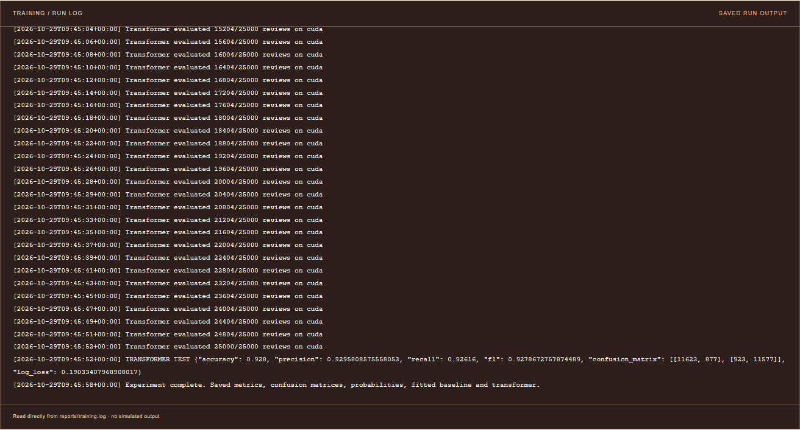

# Review Room · Review Sentiment Analyzer

A local web app that compares a trained TF-IDF + Logistic Regression classifier with a pretrained Hugging Face transformer. Enter an English movie review to see both predictions, then inspect the measured evaluation results and training evidence.

The project follows the interview task: a classical baseline, a transformer comparison, accuracy/precision/recall/F1 and confusion matrices, and an app that shows sentiment with confidence from both models.

## Measured results

Both models were evaluated on all 25,000 official IMDb test reviews. Precision, recall and F1 use the positive class. Values below are percentages, rounded to two decimal places from [the saved report](reports/metrics.json).

| Model | Accuracy | Precision | Recall | F1 |
|---|---:|---:|---:|---:|
| TF-IDF + Logistic Regression | 90.74% | 90.88% | 90.58% | 90.73% |
| DistilBERT IMDb | 92.80% | 92.96% | 92.62% | 92.79% |

**DistilBERT scored higher:** an accuracy difference of 2.056 percentage points, or 514 additional correct predictions. The local model did not beat the transformer on this test set.

The selected classical model combines word and character TF-IDF with Logistic Regression at `C = 10`. Selection used 20,000 training reviews and 5,000 validation reviews, then refitted on all 25,000 training reviews. Its validation accuracy was 91.02%. At the same `C = 10`, word-only features scored 90.84%, an observed difference of 0.18 percentage points on this validation sample. The character branch's fixed weight was not separately optimized.





## Run locally

Use Python 3.13. The first transformer download needs internet access. A Hugging Face account is not required to download public repositories.

```powershell
py -3.13 -m venv .venv
.\.venv\Scripts\python.exe -m pip install -r requirements.txt
.\.venv\Scripts\python.exe training/download_transformer.py
.\.venv\Scripts\python.exe -m uvicorn app.main:app --host 127.0.0.1 --port 8000
```

Open [http://127.0.0.1:8000](http://127.0.0.1:8000). Keep the terminal running while using the app. The app performs inference locally. Submitted review text is not sent to an inference service.

The repository includes the fitted classical model. The transformer downloader fetches the upstream checkpoint revision recorded in `reports/metrics.json`. Its weights are excluded from Git because of their size. The app requires both local model directories.

For a compatible NVIDIA GPU, install the CUDA build before training or inference:

```powershell
.\.venv\Scripts\python.exe -m pip install --force-reinstall torch==2.9.1 --index-url https://download.pytorch.org/whl/cu128
```

CPU execution remains supported. GPU availability depends on your driver and hardware.

Training artifacts and evaluation results must exist before both predictions and reports are available. To reproduce the experiment:

```powershell
.\.venv\Scripts\python.exe training/run_experiment.py --fresh
```

This downloads the dataset and transformer checkpoint, tunes the classical model using a training-derived validation split, refits it on the official training split, and evaluates both models on the same official test split. It requires more time and memory than starting the app. The saved report records the actual run configuration.

`--fresh` archives reusable outputs from an earlier run before training again. Omit it to resume an interrupted run with matching experiment settings. Keep a copy of the delivered metrics if you want to compare a new run against them.

[The experiment notebook](notebooks/experiment.ipynb) calls the same training script and displays its report artifacts. Select a Python kernel with these dependencies installed. The delivered execution evidence comes from the script's actual log and saved metrics.

## Dataset and comparator

The source is [stanfordnlp/imdb on Hugging Face](https://huggingface.co/datasets/stanfordnlp/imdb), the Large Movie Review Dataset with an official labeled training split and a separate test split. The comparator is [lvwerra/distilbert-imdb](https://huggingface.co/lvwerra/distilbert-imdb). Its Hugging Face metadata identifies `imdb` as its fine-tuning dataset and DistilBERT as its architecture. Exact revisions and the locally used counts belong in the saved run report.

The upstream [training notebook](https://huggingface.co/lvwerra/distilbert-imdb/blob/0fc02cd68445b599a9cb2da2368050e7fb31d29a/distilbert-imdb-training.ipynb) loads IMDb, fine-tunes on its official `train` split, and evaluates on its official `test` split. Our final classifier uses those same named splits. The upstream notebook does not pin the historical dataset revision, so exact byte identity across the two downloads cannot be guaranteed. The transformer also has a different initialization, tokenizer, training algorithm, and training history.

The dataset card lists its license as `other`. Consult the [dataset page](https://huggingface.co/datasets/stanfordnlp/imdb) and [Stanford source](https://ai.stanford.edu/~amaas/data/sentiment/) before redistribution or a new use. The transformer repository declares Apache-2.0. Runtime downloads are kept out of Git.

## What the comparison means

Both models are evaluated against the same labeled test reviews. This makes their test scores directly comparable on that sample. It does **not** mean their entire training histories are identical: the transformer received language pretraining before sentiment fine-tuning, while Logistic Regression learns only from the labeled reviews provided here. The upstream fine-tuning recipe differs from our validation and refit procedure. Its official test split was already used for upstream evaluation, so these results reproduce a familiar benchmark rather than an entirely unseen external audit.

An individual submitted review has no known ground-truth label. Agreement between models is not proof of correctness. A confidence score is a model probability, not a measured chance that the answer is correct. The evaluation tab uses labeled reviews to measure correctness.

Movie-review performance should not be presented as verified product-review performance. Sarcasm, mixed sentiment, short ambiguous text, other languages, and reviews outside the training domain can cause errors.

The browser accepts up to 12,000 characters per review, and the API permits up to 20,000. DistilBERT keeps the first 512 tokens, including its special tokens. The classical classifier processes the full accepted text through its learned vocabulary.

## Repository map

```text
app/                    Python API and browser interface
data/                   Dataset provenance and local evaluation data
docs/                   Interview explanation and methodology
models/                 Saved classical model and model metadata
notebooks/              Reproducible experiment notebook
reports/                Actual metrics, plots, logs, and screenshots
training/               Training and evaluation entry points
requirements.txt        Python runtime dependencies
```

## Methodology and evidence

See [the interview guide](docs/interview-guide.md) for an explanation of the pipeline and its limits. It covers probability and metric definitions as well as design choices. The [experiment protocol](docs/methodology.md) records the split policy and implemented candidate search. The website reads saved report artifacts. Displayed metrics are not hardcoded promotional claims.

The [task-to-file map](docs/deliverables.md) links each assignment requirement to its implementation or evidence.

`reports/environment.json` records the packages and hardware used for the measured run. `reports/feature_weights.json` contains real coefficients from the fitted classical classifier, also shown in the app.

The experiment ran locally on an RTX 3050 with 4 GB of VRAM and 8 GB of system RAM. Test inference is batched to avoid holding the full sparse feature matrix in memory. `reports/training.log` preserves failed attempts and retries alongside the completed run. The final saved metrics are the result to quote, rather than an intermediate log line.

## Screenshots

### Compare reviews



### Mobile layout



### Model architecture



### Evaluation reports



### Training evidence





## Responsible interpretation

The goal is to build a stronger classical baseline and measure the result honestly. Tuning only on training-derived validation data protects the test set from selection bias. A lower test score remains a valid outcome. No claim of a new architecture, guaranteed accuracy improvement, or universal sentiment understanding is made.
